# CloudClimb Project 1 — Secure Azure Application Infrastructure

## Project Overview

CloudClimb Project 1 is a hands-on Azure infrastructure project designed to build a secure, segmented cloud environment while developing practical cloud engineering and security skills.

The project is being developed incrementally. Each phase introduces new Azure resources and operational responsibilities while maintaining the network and security foundations established in previous phases.

During Week 1, I designed and deployed the core Azure network foundation, including a resource group, virtual network, three workload-specific subnets, Network Security Groups (NSGs), routing, and a consistent naming and tagging strategy.

During Week 2, I expanded the environment by deploying an Ubuntu Linux virtual machine into the Application Subnet and configuring secure SSH administration, network access controls, connectivity validation, troubleshooting, and Azure CLI management.

The long-term goal of the project is to build the infrastructure required to host the Memos application while applying Azure networking, identity, security, monitoring, and operational best practices.

---

## Project Architecture

The environment uses a three-tier network design inside an Azure Virtual Network:

* **Application Tier** — Hosts application compute resources.
* **Data/Backend Tier** — Reserved for backend and data services.
* **Management Tier** — Reserved for administrative and management workloads.

Separating these workloads into dedicated subnets provides clearer security boundaries and allows network access controls to be applied independently to each tier.

### Azure Environment

| Resource | Configuration |

|---|---|

| Resource Group | `rg-cloudclimb-dev-eastus` |

| Virtual Network | `vnet-cloudclimb-dev-eastus` |

| VNet Address Space | `10.10.0.0/16` |

| Application Subnet | `snet-app-dev-eastus` — `10.10.1.0/24` |

| Data/Backend Subnet | `snet-data-dev-eastus` — `10.10.2.0/24` |

| Management Subnet | `snet-mgmt-dev-eastus` — `10.10.3.0/24` |

| Application NSG | `nsg-app-dev-eastus` |

| Data NSG | `nsg-data-dev-eastus` |

| Management NSG | `nsg-mgmt-dev-eastus` |

---

### Week 1 Architecture

The Week 1 architecture established the network foundation before any application compute resources were deployed.

The architecture consisted of:

* One Azure Resource Group
* One Azure Virtual Network
* Three segmented subnets
* Three Network Security Groups
* Azure system routing
* Reserved network capacity for future workloads



### What I Learned

Week 1 helped me understand why cloud infrastructure should be designed before workloads are deployed.

I learned how CIDR ranges define network address space, how subnets can separate workloads into security boundaries, how NSGs provide network-level traffic controls, and how Azure system routing supports communication within a virtual network.

I also learned the importance of planning IP address ranges so that future resources can be added without creating overlapping address spaces or requiring unnecessary network redesign.

---

## Week 2 — Application Compute

### Objective

The objective of Week 2 was to introduce the first compute workload into the Azure environment while maintaining the network segmentation and security foundation established during Week 1.

I deployed an Ubuntu Linux virtual machine into the Application subnet and configured secure administrative access using SSH public-key authentication.

This phase also focused on validating network connectivity, managing the VM through Azure CLI, troubleshooting SSH connectivity, and updating the architecture documentation to reflect the new compute layer.

### Linux Virtual Machine

The first compute resource deployed into the environment was:

| Configuration | Value |

|---|---|

| VM Name | `vm-app-dev-eastus` |

| Operating System | Ubuntu Server 22.04 LTS |

| Architecture | ARM64 |

| VM Size | `Standard_B2pts_v2` |

| Subnet | `snet-app-dev-eastus` |

| Private IP | `10.10.1.4` |

| Authentication | SSH public key |

The VM was placed inside `snet-app-dev-eastus` because it represents the application workload for the CloudClimb environment.

Keeping the application workload in its dedicated subnet allows application traffic and security controls to be managed independently from the Data/Backend and Management tiers.

### Network Interface

The VM's network interface connects the virtual machine to the Application subnet.

The network interface was assigned the private IPv4 address:

`10.10.1.4`

This address allows the VM to communicate within the Azure virtual network according to the network and security rules applied to the environment.

### SSH Administration

Administrative access to the Linux VM was configured using SSH public-key authentication.

SSH access uses:

- Protocol: TCP

- Port: `22`

- Username: `azureuser`

- Authentication: SSH public/private key pair

Separate SSH key pairs were configured for my desktop and laptop environments. This allowed both administrative devices to access the VM without sharing the same private SSH key.

Private keys remain stored on their respective administrative devices.

### Network Security Group

SSH access is controlled by:

`nsg-app-dev-eastus`

The custom inbound rule:

`Allow-SSH-MyIP`

allows TCP port `22` only from an approved public source IP.

This prevents SSH from being intentionally exposed to all Internet source addresses and demonstrates the principle of restricting administrative access to known sources.

### Connectivity Validation

After connecting to the VM, I validated the Linux environment and network configuration using commands such as:

`hostname`

`ip addr show eth0`

`uname -a`

`df -h`

`free -h`

The VM reported the expected hostname and private IP address.

Outbound Internet connectivity was also validated using:

`sudo apt update`

The VM successfully contacted Ubuntu package repositories and retrieved current package metadata, confirming that outbound connectivity was functioning.

### SSH Troubleshooting Exercise

During Week 2, I performed a troubleshooting exercise involving the Application NSG.

The approved source IP configured in the `Allow-SSH-MyIP` rule was changed so that it no longer matched the public IP of the administrative workstation.

A new SSH connection attempt resulted in a connection timeout.

I investigated the network path and reviewed the NSG inbound rule. The source IP mismatch was identified as the cause of the connectivity failure.

After restoring the correct source IP in the NSG rule, SSH connectivity was successfully restored.

This exercise helped demonstrate the difference between network connectivity and authentication failures.

A TCP connection timeout can indicate that traffic is being blocked or cannot reach the destination, while an SSH authentication error such as `Permission denied (publickey)` indicates that the SSH service was reached but the provided credentials were not accepted.

### Azure CLI Management

Azure CLI was configured on my administrative workstation to manage Azure resources from PowerShell.

After authenticating to the correct Azure subscription, I used Azure CLI to inspect and manage the virtual machine.

The VM was deallocated using:

`az vm deallocate --resource-group rg-cloudclimb-dev-eastus --name vm-app-dev-eastus`

The VM power state was verified using Azure CLI after the operation.

Deallocating the VM when it is not required is part of the project's cost-management strategy because compute resources should not remain running unnecessarily during a development lab.

### Week 2 Architecture

The architecture diagram was updated to include the new application compute and administrative access path.

The updated architecture includes:

- Admin Workstation

- SSH management over TCP port 22

- Source IP restriction

- Application Network Security Group

- `Allow-SSH-MyIP` rule

- Network interface

- Private IP `10.10.1.4`

- Ubuntu application VM

- Existing Application, Data/Backend, and Management subnets



### What I Learned

Week 2 helped me understand how compute resources integrate with an existing Azure network architecture.

I learned that deploying a VM involves more than creating a server. The VM depends on networking components such as the subnet, network interface, IP addressing, Network Security Group rules, and routing in order to communicate securely.

I also gained practical experience with SSH public-key authentication and learned why separate administrative devices can use separate SSH key pairs instead of sharing private keys.

The SSH troubleshooting exercise strengthened my understanding of the difference between network connectivity and authentication problems. When SSH timed out, I learned to investigate the network path and NSG source IP before assuming that the SSH key was the problem.

Finally, I practiced managing Azure resources from PowerShell using Azure CLI and learned how VM deallocation can be incorporated into a development workflow to reduce unnecessary compute usage.

---

## Week 3 — Memos Application & PostgreSQL Integration

### Objective

The objective of Week 3 was to extend the existing Azure network and Ubuntu application VM into a functioning, database-backed application environment. I deployed Memos using Docker, connected it to Azure Database for PostgreSQL Flexible Server, verified persistence, and practiced diagnosing an application-to-database authentication failure.

The initial design called for PostgreSQL private networking within the East US Data/Backend subnet. Because the subscription could not provision PostgreSQL Flexible Server in East US at the time, I implemented a **temporary Central US database with a restricted public endpoint**. This is a documented deviation from the planned private-network architecture, not a completed private deployment.

### Infrastructure Reused from Weeks 1–2

| Resource | Configuration |
|---|---|
| Resource Group | `rg-cloudclimb-dev-eastus` |
| Virtual Network | `vnet-cloudclimb-dev-eastus` (`10.10.0.0/16`) |
| Application Subnet | `snet-app-dev-eastus` (`10.10.1.0/24`) |
| Data/Backend Subnet | `snet-data-dev-eastus` (`10.10.2.0/24`) |
| Management Subnet | `snet-mgmt-dev-eastus` (`10.10.3.0/24`) |
| Ubuntu VM | `vm-app-dev-eastus`, Ubuntu Server 22.04 LTS, East US |
| VM Private IP | `10.10.1.4` |
| VM Public IP during testing | `20.127.47.100` (subject to change) |
| Application NSG | `nsg-app-dev-eastus` |

The existing VM and network foundation were reused rather than deploying a separate application environment.

### Docker and Memos Deployment

Docker was installed on the Ubuntu VM, and the Memos container image was pulled from `neosmemo/memos:stable`. Memos listens on TCP port `5230`, which was published from the Docker container to the VM.

The application was initially launched with its default SQLite storage to confirm that Docker, the VM, the application port, and browser access worked before integrating PostgreSQL. After validating the application, the temporary SQLite-backed container was stopped and removed. The host data directory was retained; this was a container replacement, not a SQLite-to-PostgreSQL data migration.

The final Memos deployment used the PostgreSQL driver and a protected environment file:

```bash
sudo docker run -d \
  --name memos \
  --restart unless-stopped \
  -p 5230:5230 \
  --env-file /home/azureuser/.config/memos/postgres.env \
  -v /home/azureuser/.memos:/var/opt/memos \
  neosmemo/memos:stable
```

The environment file contains the `MEMOS_DRIVER=postgres` setting and a PostgreSQL connection string. **The actual environment file, connection string with password, and private keys are not stored in this repository.** The environment directory was restricted to the VM user (`700`), and the file was restricted to the VM user (`600`).

### Azure Database for PostgreSQL Flexible Server

| Configuration | Value |
|---|---|
| Server | `cloudclimb-project01-postgres-temp` |
| Region | **Central US** (temporary workaround) |
| Service | Azure Database for PostgreSQL Flexible Server |
| PostgreSQL Version | 18.6 at deployment |
| Compute | Burstable B1ms, 1 vCore, 2 GiB RAM |
| Storage | 32 GiB |
| Database | `memos` |
| Administrator Username | `cloudadmin` |
| Server Hostname | `cloudclimb-project01-postgres-temp.postgres.database.azure.com` |
| Database Port | TCP `5432` |
| Network Access | Public endpoint with firewall restricted to the VM's verified outbound public IP |
| Transport Encryption | TLS, using `sslmode=require` in the lab connection |

PostgreSQL was deployed in Central US after East US provisioning was blocked by a subscription/region capacity restriction. A Microsoft support request was opened for East US availability. The current database **does not use** the East US delegated Data Subnet, a private endpoint, or an Azure Private DNS zone.

The Data/Backend subnet was delegated to `Microsoft.DBforPostgreSQL/flexibleServers` in preparation for a future private deployment, but that delegation is not used by the temporary Central US server.

### Application-to-Database Connectivity

I tested database access from the East US Ubuntu VM in stages:

1. **DNS resolution:** `nslookup` successfully resolved the PostgreSQL server hostname.
2. **Network reachability:** `nc -vz cloudclimb-project01-postgres-temp.postgres.database.azure.com 5432` successfully connected to TCP port `5432`.
3. **Database authentication:** The PostgreSQL command-line client (`psql`) connected to the `memos` database using the administrator account and `sslmode=require`.
4. **Application integration:** Memos logs confirmed `Database driver: postgres` and successful startup on TCP port `5230`.

The PostgreSQL firewall was configured to permit only the VM's verified outbound public IP during testing. The VM's Azure public IP and its outbound source IP should not be assumed to match without checking.

### Network Security and Traffic Flow

| Flow | Port / Protocol | Control |
|---|---|---|
| Administrator → Ubuntu VM | SSH / TCP `22` | Application NSG restricts approved source IPs; SSH keys authenticate the user |
| External browser → Memos on VM | HTTP / TCP `5230` | Application NSG permits lab application access |
| Memos on VM → PostgreSQL Flexible Server | PostgreSQL / TCP `5432` over TLS | PostgreSQL public-endpoint firewall restricts the verified VM outbound public IP |

The browser-accessible Memos application currently uses **HTTP**, not HTTPS. This is suitable only for the controlled lab; a production deployment would use TLS at the application edge, stricter inbound access, and private database networking. The `sslmode=require` setting encrypts the database session but does not provide the same server identity verification as `verify-full` with a trusted CA configuration.

### Functional and Persistence Validation

After starting the PostgreSQL-backed container, I opened Memos in the browser and completed the initial administrator setup. I then created a test memo describing the Azure VM and PostgreSQL integration.

I restarted the container and refreshed the browser. The original test memo remained available, demonstrating that application data survived the container restart. The Docker logs showed that Memos started successfully with the PostgreSQL database driver.

Useful verification commands included:

```bash
sudo docker ps
sudo docker logs --tail 50 memos
sudo docker restart memos
```

### Week 3 Troubleshooting Challenge — PostgreSQL Authentication Failure

I conducted a controlled troubleshooting simulation by entering an incorrect PostgreSQL password in the Memos environment file. After recreating the container with the modified configuration, the application failed database initialization. Container logs identified the cause:

```text
FATAL: password authentication failed for user "cloudadmin" (SQLSTATE 28P01)
```

I corrected the stored database credential, kept the environment file permissions restricted, and recreated the container so Docker would load the updated configuration. Subsequent logs confirmed Memos started with `Database driver: postgres`, and the original memo remained accessible in the browser.

**Root cause:** Incorrect credentials in the PostgreSQL connection configuration, rather than a confirmed DNS, routing, or firewall failure.

**Lesson:** Inspect application logs before changing network controls. Updating a Docker `--env-file` on disk does not automatically change the environment of an already-created container; the container must be recreated to load the new values.

For the Week 2 SSH investigation and the complete Week 3 incident record, see [troubleshooting.md](troubleshooting.md).

### Week 3 Architecture

The architecture shows the Ubuntu VM hosting Docker and Memos in East US, external browser access through the VM's public IP, and the temporary PostgreSQL Flexible Server in Central US. The PostgreSQL connection uses its public FQDN over TCP `5432` with TLS and source-IP firewall restrictions.



**Architecture exception:** The delegated East US Data/Backend subnet is reserved for a future private PostgreSQL deployment; the current Central US PostgreSQL server is not located in that subnet.

### Operational Considerations and Next Steps

- **Costs:** VM compute and managed PostgreSQL may incur charges. Deallocating the VM does not automatically stop PostgreSQL charges. Check Azure Cost Management and the applicable free-service limits; cross-region traffic can also have a cost.
- **Secrets:** Do not commit `postgres.env`, database passwords, SSH private keys, or full credential-bearing connection strings. Rotate exposed secrets immediately if they are ever published.
- **Public exposure:** Replace direct HTTP access on TCP `5230` with an HTTPS reverse proxy or other secure application ingress before production use.
- **Network design:** When East US provisioning becomes available, deploy PostgreSQL with supported private VNet integration, configure the required private DNS, migrate data, test connectivity, and remove the temporary public firewall exception.
- **IP changes:** Recheck the VM's actual outbound public IP if networking or VM allocation changes; a different outbound IP can break the database firewall rule.
- **Lifecycle:** Review resource status and cost before leaving the lab idle; managed database resources require their own lifecycle management.

### What I Learned

Week 3 strengthened my understanding of how application services, containers, managed databases, DNS, firewall rules, and TLS fit together in a cloud environment.

I learned to validate connectivity layer by layer—hostname resolution, TCP reachability, database authentication, application startup, and browser functionality—rather than assuming a successful deployment means the application is fully operational.

I also practiced responding to a real deployment constraint. Instead of claiming the original private-network design was complete, I documented a temporary cross-region public-endpoint workaround and identified the security and migration work that remains. Finally, the authentication troubleshooting challenge reinforced the importance of log analysis, protected credentials, container recreation, and persistence testing.

# Week 4 — Infrastructure as Code and CI/CD Automation

## Project Overview

During Week 4 of my CloudClimb Azure Cloud Infrastructure project, I focused on Infrastructure as Code (IaC), Terraform, GitHub Actions, and secure Azure authentication.

The objective was to build a repeatable infrastructure configuration, implement automated validation and planning, and practice troubleshooting CI/CD pipeline failures.

**Deployment status:** Terraform configurations were validated and planned successfully. No Azure infrastructure was deployed through Terraform during this week.

## Architecture Diagram


The architecture illustrates the development workflow, GitHub Actions CI/CD pipeline, Microsoft Entra ID authentication through OIDC, and the relationship to the existing Week 3 Azure infrastructure.

The Week 4 Terraform configuration is a separate proposed infrastructure lab, not a deployment of the existing Week 3 resources.

## Tools and Technologies

- Terraform CLI
- Microsoft Azure
- Microsoft Entra ID
- Azure Role-Based Access Control (RBAC)
- Git and GitHub
- GitHub Actions
- Visual Studio Code
- PowerShell
- OpenID Connect (OIDC)

## Terraform Infrastructure Configuration

I created Terraform configuration files defining:

- Azure Resource Group
- Azure Virtual Network (`10.10.0.0/16`)
- Application Subnet (`10.10.1.0/24`)
- Database Subnet (`10.10.2.0/24`)
- Management Subnet (`10.10.3.0/24`)
- Database Network Security Group (NSG)
- Security rules permitting PostgreSQL traffic on TCP port 5432 from the application subnet
- Terraform outputs for infrastructure resource information

The configuration was checked using:

```bash
terraform fmt -check
terraform validate
terraform plan
```

The plan reported **7 resources to add, 0 to change, and 0 to destroy**.

This represented proposed infrastructure changes only.

## GitHub Actions CI/CD Pipeline

I configured a GitHub Actions workflow to automatically execute Terraform checks when a pull request is opened.

The workflow performs:

1. Repository checkout
2. Terraform setup
3. Terraform formatting verification
4. Terraform initialization
5. Terraform configuration validation
6. Azure authentication using OIDC
7. Terraform plan

The pipeline can also be triggered manually through `workflow_dispatch`.

## Secure Azure Authentication

I configured a Microsoft Entra ID application registration and federated credentials to authenticate GitHub Actions with Azure.

This included:

- GitHub Actions OIDC authentication
- Microsoft Entra ID app registration
- Federated identity credentials
- Azure service principal
- Azure RBAC permissions
- GitHub Actions variables for Azure identifiers

OIDC enabled authentication without storing a long-lived Azure client secret in the GitHub repository.

## Deployment Safety

I created a separate manually triggered Terraform deployment workflow.

For safety, the Terraform Apply step remains disabled.

This prevents accidental infrastructure deployment and allows infrastructure plans to be reviewed before changes are approved.

## Pipeline Troubleshooting Challenge

During Task 23, I intentionally introduced a Terraform formatting issue to simulate a CI/CD pipeline failure.

The GitHub Actions workflow failed during the Terraform Format step.

I investigated the execution logs, identified the formatting issue in `main.tf`, and corrected it locally using Terraform formatting commands.

After committing and pushing the correction, I confirmed that the GitHub Actions workflow passed successfully.

The troubleshooting process was documented in `troubleshooting.md` in my Terraform repository.

## GitHub Workflow and Change Management

I practiced:

- Creating feature branches
- Committing infrastructure changes
- Opening pull requests
- Reviewing automated checks
- Troubleshooting failed pipelines
- Merging validated changes into the main branch
- Documenting technical incidents

## What I Learned

Week 4 strengthened my understanding of Infrastructure as Code and the importance of validating changes before deployment.

I learned how Terraform provides repeatable infrastructure configurations, how GitHub Actions automates validation, and how OIDC enables secure authentication between GitHub and Azure.

I also gained practical experience troubleshooting pipeline failures and documenting root causes.

Most importantly, I learned that successful cloud infrastructure engineering requires more than writing configurations. It requires planning, testing, security controls, change management, and clear technical documentation.

## Terraform Source Code

[View the CloudClimb Azure Terraform Repository](https://github.com/deo-codes/CloudClimb-Azure-Terraform)

*Note: The source repository link will only be accessible to other users after its visibility is changed to public.*